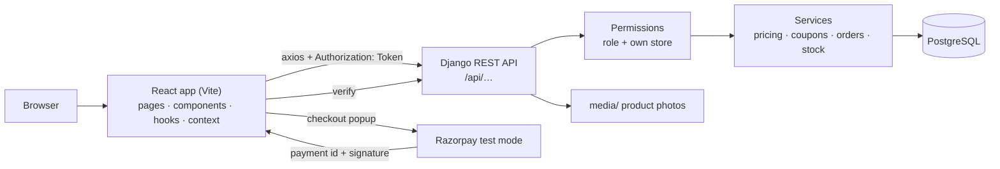
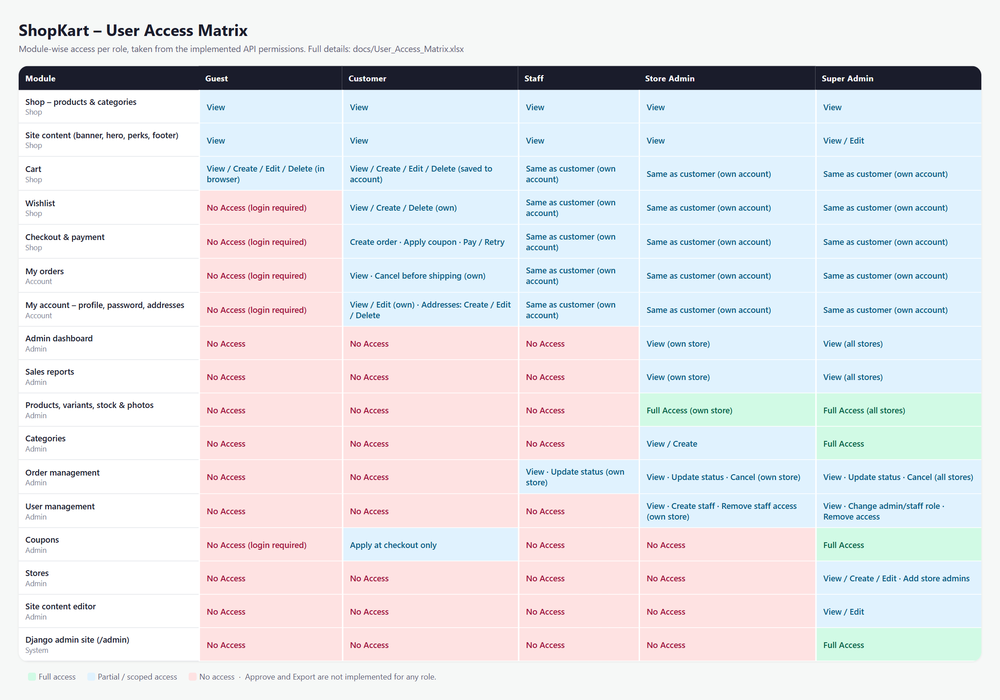
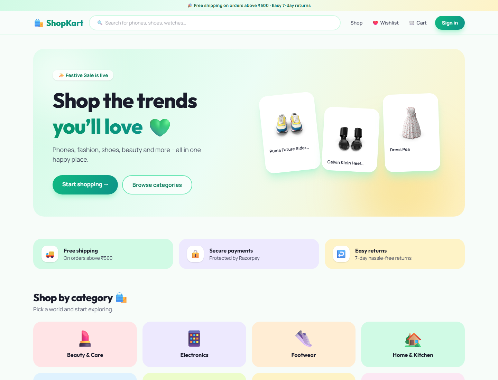
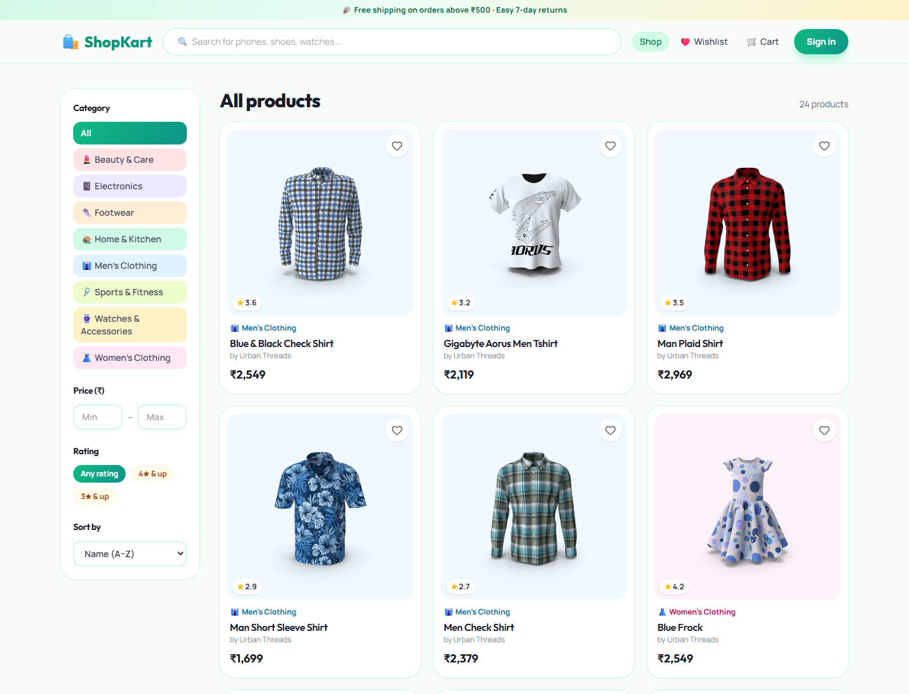
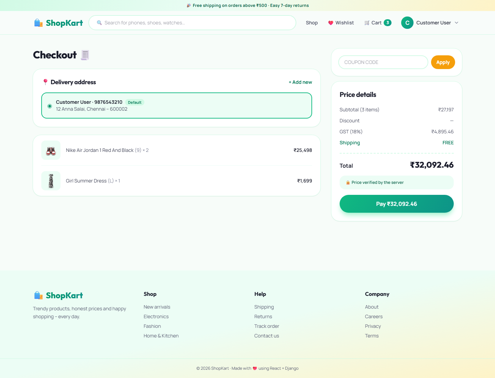
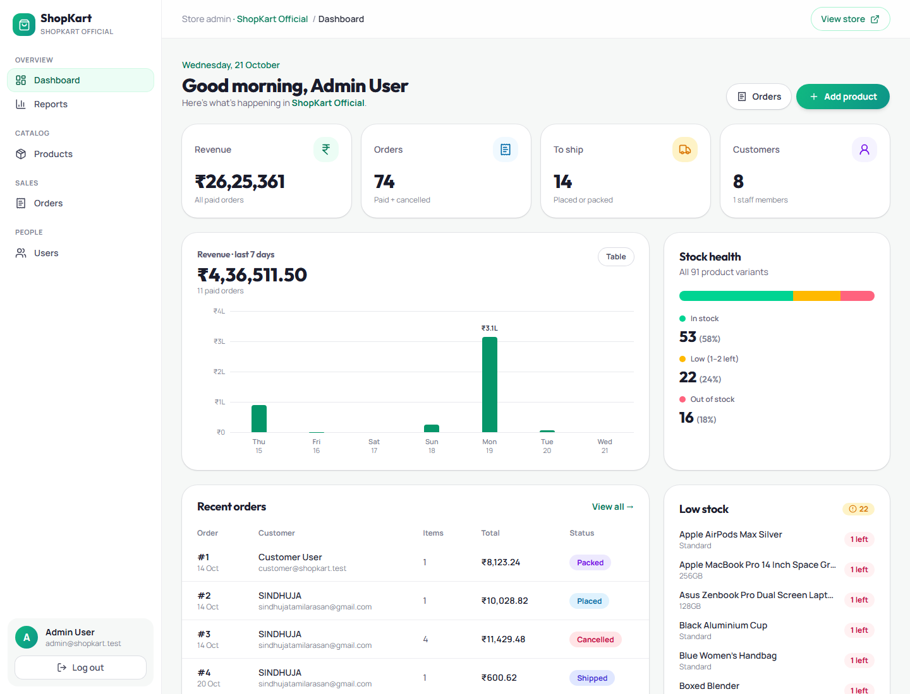
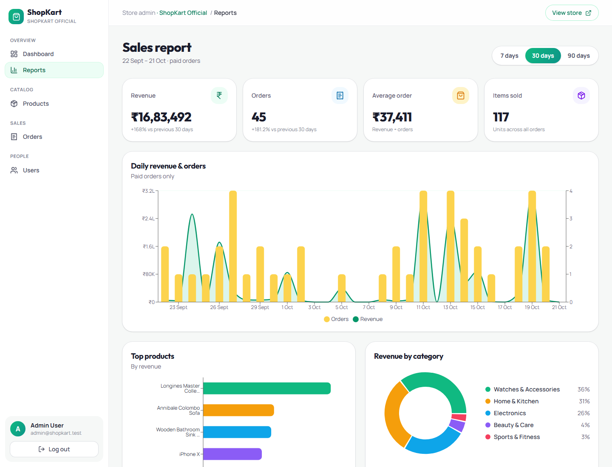
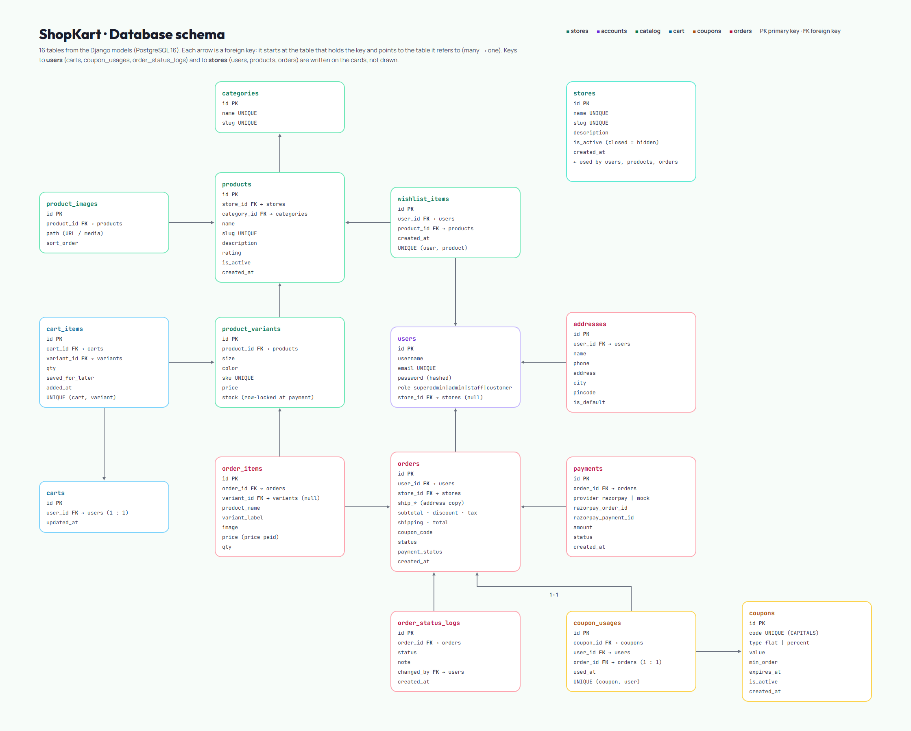

# 🛍️ ShopKart – Multi-store E-commerce with Admin Panel

## 1. Project overview

**ShopKart** is a small Amazon / Flipkart-style online marketplace.

- **Customers** browse products from several stores, filter and search, add to a cart or wishlist,
  apply coupons, pay with Razorpay (test mode) and track or cancel their orders.
- **Store admins** run one store: products, variants, stock, photos, orders, staff, dashboard and reports.
- **Staff** pack, ship and deliver the orders of their store.
- **The super admin** owns the marketplace: creates stores and store admins, and manages coupons,
  categories and the shop's texts.

**Purpose.** A training project that solves the hard parts of a real shop correctly:
the cart stays right across guest / login, tabs and refresh; prices are always recalculated on the server;
payments are verified on the server; and when two people buy the last item at the same time, only one succeeds.

---

## 2. Technology stack

| Layer | Technology | Version | Used for |
|---|---|---|---|
| **Language** | JavaScript (ES modules, JSX) | – | Frontend |
| **Language** | Python | 3.14 | Backend |
| **Frontend framework** | React | 19 | UI components, state, hooks |
| **Build tool** | Vite | 8 | Dev server, production build |
| **Routing** | React Router (`react-router-dom`) | 7 | Pages, nested layouts, role-protected routes |
| **Styling** | Tailwind CSS (`@tailwindcss/vite`) | 4 | Design tokens and utility classes |
| **HTTP client** | axios | 1.x | All API calls (`src/api/`) with a token interceptor |
| **Charts** | Recharts | 3 | Sales report (lazy-loaded) |
| **Icons** | lucide-react | 1.x | Admin and account icons |
| **Linting** | oxlint | 1.x | `npm run lint` |
| **Backend framework** | Django | 6.1 | Models, ORM, migrations, admin site |
| **API** | Django REST Framework | 3.18 | REST API, token auth, permissions, pagination |
| **CORS** | django-cors-headers | 4.9 | Allow the React dev server to call the API |
| **Config** | python-dotenv | 1.2 | Read settings from `backend/.env` |
| **Database** | PostgreSQL | 16 (Docker) | Main database (row locks for stock) |
| **DB driver** | psycopg (+ binary) | 3.3 | Django ↔ PostgreSQL |
| **Fallback DB** | SQLite | built-in | Used only when `DB_NAME` is empty |
| **Payments** | Razorpay Checkout (test mode) | v1 script | Payment popup; HMAC signature checked by the backend. A mock payment screen is used when no keys are set |
| **Images** | Local storage (`backend/media/`) | – | Uploaded product photos |
| **Tools** | Git + GitHub, Docker, Node.js / npm, VS Code | – | Version control, database container, frontend tooling |

Exact versions: [`backend/requirements.txt`](backend/requirements.txt) and [`frontend/package.json`](frontend/package.json).

---

## 3. Setup and installation

### Prerequisites
- **Node.js 20+** (with npm), **Python 3.12+**, **Git**
- **Docker Desktop** for PostgreSQL – or leave `DB_NAME` empty in `backend/.env` to use SQLite

### 3.1 Database – PostgreSQL in Docker (no installer or admin rights needed)
```bash
docker run -d --name shopkart-db --restart unless-stopped -e POSTGRES_DB=shopkart -e POSTGRES_USER=shopkart -e POSTGRES_PASSWORD=change-me -p 127.0.0.1:5434:5432 -v shopkart-pgdata:/var/lib/postgresql/data postgres:16
```
Port **5434** avoids clashes with other local PostgreSQL containers. Use the same password in `backend/.env`.

### 3.2 Backend (Windows, Command Prompt)
```bash
cd backend
python -m venv .venv
.venv\Scripts\python -m pip install -r requirements.txt
copy .env.example .env
.venv\Scripts\python manage.py migrate
.venv\Scripts\python manage.py seed_products
.venv\Scripts\python manage.py seed_stores
.venv\Scripts\python manage.py seed_users
.venv\Scripts\python manage.py runserver 127.0.0.1:8000
```
Check: http://127.0.0.1:8000/api/health/ → `{"status": "ok"}`

| Seed command | What it creates |
|---|---|
| `seed_products` | 8 categories and 100 products with variants and real photos (from `catalog/seed/products.json`) |
| `seed_stores` | The demo stores (*ShopKart Official*, *Urban Threads*) |
| `seed_users` | One demo account per role (below) |
| `seed_orders` | Optional: 150 **fake** orders to try the dashboard and reports (`--clear` removes them) |

> - Use `.venv\Scripts\python -m pip` – a plain `pip.exe` can be blocked by Windows Device Guard.
> - Use `127.0.0.1`, not `localhost`: Docker also listens on port 8000 on the dev machine.

### 3.3 Frontend
```bash
cd frontend
npm install
copy .env.example .env
npm run dev
```
Open http://localhost:5173

| Script | Purpose |
|---|---|
| `npm run dev` | Development server with hot reload |
| `npm run build` | Production build into `frontend/dist/` |
| `npm run lint` | Lint with oxlint |
| `npm run preview` | Preview the production build |

### 3.4 Demo accounts (password for all: `Shop@1234`, development only)

| Role | Email | Sees |
|---|---|---|
| Super admin | superadmin@shopkart.test | All stores · stores, coupons, categories, site content |
| Store admin | admin@shopkart.test | ShopKart Official only |
| Store admin | urban@shopkart.test | Urban Threads only |
| Staff | staff@shopkart.test | ShopKart Official orders |
| Customer | customer@shopkart.test | The shop |

### 3.5 Tests
```bash
cd backend
.venv\Scripts\python manage.py test
```
69 backend tests: price rules, coupons, payments and signatures, stock, the "last item" race
(a real two-thread test on PostgreSQL), store isolation and role permissions.

---

## 4. Folder structure and architecture

### 4.1 Architecture



**Key design decisions**

| Decision | Why |
|---|---|
| The browser sends only **variant ids and quantities**; the server recalculates every price (`cart/services.py`) | Users can change anything in their browser |
| Payments are trusted only after the **HMAC signature** check (`orders/payments.py`) | A "success" from the browser can be faked |
| Stock is reduced **only after payment**, with a row lock + conditional update (`orders/services.py`) | Two buyers of the last item → only one succeeds; stock never goes negative |
| Every admin query goes through `for_my_store()` (`accounts/permissions.py`) | A store admin or staff member never sees another store's data |
| Roles are checked **in the API** (permission classes); React routes only hide pages | Hiding a page is not security |
| One store per order | Each store ships its own orders |
| Order items **copy** the name, price and image | Old orders stay correct when a product changes |

### 4.2 Folder structure

```
ecommerce-shop/
├── README.md
├── docs/                         documentation
│   ├── User_Access_Matrix.xlsx   roles × module permissions
│   ├── user-access-matrix.png    image of the matrix
│   ├── generate_access_matrix.py regenerates the two files above
│   ├── database-design.md        tables, relations, business rules
│   ├── database-schema.png       schema diagram
│   └── screenshots/              screenshots used in this README
├── backend/                      Django project
│   ├── config/                   settings, root URLs, health check
│   ├── accounts/                 User model (role + store), login / register / profile, permission classes
│   ├── stores/                   stores and store admins (super admin)
│   ├── catalog/                  categories, products, variants, images, wishlist + seed data
│   ├── cart/                     price rules, quote API, saved cart, guest-cart merge
│   ├── coupons/                  coupon model and rules
│   ├── orders/                   addresses, orders, status log, payments, stock, cancel
│   ├── backoffice/               admin panel APIs: products, uploads, categories, coupons, orders, users, reports
│   ├── dashboard/                admin dashboard API
│   ├── sitecontent/              announcement, hero, perks and footer texts
│   ├── media/                    uploaded product photos (not in Git)
│   └── requirements.txt
└── frontend/                     React app
    └── src/
        ├── api/                  one file per area; all axios calls live here
        ├── components/           reusable UI (ProductCard, PriceSummary, ProtectedRoute, …)
        │   └── admin/            admin-only UI (SalesChart, VariantsEditor, reports/, …)
        ├── context/              Auth, Cart (useReducer), Wishlist, Site providers
        ├── hooks/                custom hooks: useApi, useCart, useProducts, usePaymentFlow, useDebounce, …
        ├── layouts/              CustomerLayout, AdminLayout
        ├── pages/                shop pages, account/ and admin/ pages
        └── utils/                formatting, pricing, roles, Razorpay loader
```

Database tables and relations: [`docs/database-design.md`](docs/database-design.md) and the [schema diagram](docs/database-schema.png).

---

## 5. Modules and functionality

### Shop (customers)
| Module | Functionality |
|---|---|
| **Home** | Hero, perks, category tiles, top-rated products (texts editable by the super admin) |
| **Product list** | Search, category, price-range and rating filters, sorting, infinite scroll; filters are kept in the URL |
| **Product detail** | Photo gallery, size / colour / storage variants with their own price and stock, "Sold by" store, recently viewed |
| **Cart** | Add within the stock limit, + / − quantity, save for later, price summary. Guest cart in `localStorage`, saved to the account after login (merged), synced across tabs. One store per order |
| **Wishlist** | Save / remove products (login required) |
| **Checkout** | Saved addresses, coupon box, server-verified total (subtotal → discount → GST 18% → shipping, free from ₹500) |
| **Payment** | Razorpay test popup or mock screen; signature verified; failure → retry |
| **My orders** | Order list and status timeline (placed → packed → shipped → delivered); cancel before shipping (stock returned) |
| **My account** | Edit name, change password, manage addresses (add / edit / delete / set default) |

### Admin panel
| Module | Functionality |
|---|---|
| **Dashboard** | KPIs, 7-day revenue chart, stock health, recent orders, low-stock list, products per category |
| **Reports** | Daily revenue, top products, revenue by category for 7 / 30 / 90 days (Recharts) |
| **Products** | List with category tabs and search; create / edit with photo upload (JPG / PNG / WEBP, max 3 MB) or URL, variants table (SKU, price, stock), show / hide; delete |
| **Categories** | Store admins add a category; the super admin renames or deletes (only when empty) |
| **Orders** | Status tabs, search, expandable details; move status forward; admins cancel before shipping |
| **Users** | Store admin: customers and own staff, create staff logins, remove staff access. Super admin: everyone, admin ⇄ staff, remove access |
| **Coupons** | Flat / % coupons with minimum order, expiry, pause / activate, usage count (one use per customer) |
| **Stores** | Create stores, activate / deactivate, create store admin logins |
| **Site content** | Announcement strip, hero texts, perks, footer links |

---

## 6. User roles and responsibilities

| Role | Responsibilities | Data scope | Lands on after login |
|---|---|---|---|
| **Guest** | Browse, search, filter, keep a cart in the browser | Public data | Shop |
| **Customer** | Shop, wishlist, check out and pay, track / cancel own orders, manage own profile and addresses | Own records only | Shop |
| **Staff** | Pack, ship and deliver orders (move status forward) | Orders of their store | `/staff/orders` |
| **Store admin** | Products, stock, photos, orders (incl. cancel), staff, categories (add), dashboard, reports | Their own store | `/admin` |
| **Super admin** | Stores and store admins, coupons, categories, site content, all stores' data, Django admin site | All stores | `/admin` |

- New sign-ups are **always customers**. Staff are always **new** logins created by a store admin;
  store admins are created by the super admin. A customer account is never promoted, and nobody can change their own role.
- Staff and admins can also shop with their own account.

### User Access Matrix

Full module-wise permissions (View, Create, Edit, Delete, Approve, Export), role descriptions and
where each rule is enforced in the code: **[`docs/User_Access_Matrix.xlsx`](docs/User_Access_Matrix.xlsx)**



> **Approve** and **Export** are not implemented for any role (there is no approval workflow and no data export yet).
> To update the matrix after a permission change: `pip install openpyxl`, edit the data in
> [`docs/generate_access_matrix.py`](docs/generate_access_matrix.py) and run it.

---

## 7. Configuration and dependencies

### `backend/.env` (copy from `.env.example`; never commit `.env`)

| Variable | Example | Meaning |
|---|---|---|
| `SECRET_KEY` | `change-me` | Django secret key – use a long random value outside development |
| `DEBUG` | `True` | Debug pages; must be `False` in production |
| `DB_NAME` | `shopkart` | PostgreSQL database. **Empty → SQLite** (`backend/db.sqlite3`) |
| `DB_USER` / `DB_PASSWORD` | `shopkart` / `change-me` | PostgreSQL login |
| `DB_HOST` / `DB_PORT` | `127.0.0.1` / `5434` | PostgreSQL address (the Docker container above) |
| `CORS_ALLOWED_ORIGINS` | `http://localhost:5173,http://127.0.0.1:5173` | Frontend addresses allowed to call the API |
| `RAZORPAY_KEY_ID` / `RAZORPAY_KEY_SECRET` | `rzp_test_…` | Razorpay **test** keys. Empty → mock payment screen |

### `frontend/.env`

| Variable | Example | Meaning |
|---|---|---|
| `VITE_API_URL` | `http://127.0.0.1:8000/api` | Base URL of the Django API (restart `npm run dev` after changing it) |

### Important settings (`backend/config/settings.py`)
- **Authentication:** DRF `TokenAuthentication` – React stores the token and sends `Authorization: Token <key>`.
- **Default permission:** `IsAuthenticated` – every API needs login unless a view says `AllowAny`.
- **Pagination:** 12 items per page. **Time zone:** `Asia/Kolkata`.
- **Uploads:** `MEDIA_ROOT = backend/media`, served at `/media/` in development.
- **Custom user model:** `AUTH_USER_MODEL = 'accounts.User'` (role + store).

### Payments – Razorpay test mode
1. Create a free account at https://razorpay.com → **Test mode** → Settings → API Keys → Generate.
2. Put the keys in `backend/.env` and restart the backend. Checkout then opens the real Razorpay popup (test cards, no real money).
3. Without keys the mock screen offers *Pay successfully* / *Make payment fail*. In both modes the backend verifies the payment before reducing stock.

---

## 8. API reference

| Method | URL | Access |
|---|---|---|
| GET | `/api/health/` | Anyone |
| POST | `/api/auth/register/`, `/api/auth/login/` | Anyone |
| POST | `/api/auth/logout/`, `/api/auth/change-password/` · GET / PATCH `/api/auth/me/` | Logged in |
| GET | `/api/categories/`, `/api/products/` (search, category, price, rating, ordering, page), `/api/products/<slug>/` | Anyone |
| GET | `/api/site/` | Anyone |
| GET / POST · DELETE | `/api/wishlist/` · `/api/wishlist/<product_id>/` | Logged in (own) |
| POST | `/api/cart/quote/` – server-side price (items + coupon) | Anyone |
| GET / PUT · POST | `/api/cart/` · `/api/cart/merge/` | Logged in (own) |
| GET / POST · PATCH / DELETE | `/api/addresses/` · `/api/addresses/<id>/` | Logged in (own) |
| GET / POST | `/api/orders/` – my orders / place order | Logged in (own) |
| GET · POST | `/api/orders/<id>/` · `/pay/`, `/pay/verify/`, `/pay/failed/`, `/cancel/` | Order owner |
| GET | `/api/admin/dashboard/` | Store admin (own store), super admin |
| GET | `/api/manage/reports/sales/?days=7\|30\|90` | Store admin (own store), super admin |
| CRUD · POST | `/api/manage/products/` · `/api/manage/uploads/` | Store admin (own store), super admin |
| GET / POST · PATCH / DELETE | `/api/manage/categories/` · `/api/manage/categories/<id>/` | Admins · super admin only |
| GET · POST | `/api/manage/orders/?status=&search=` · `/api/manage/orders/<id>/next-status/` | Staff, store admin (own store), super admin |
| POST | `/api/manage/orders/<id>/cancel/` | Store admin (own store), super admin |
| GET · POST · PATCH | `/api/manage/users/` · `/api/manage/staff/` · `/api/manage/users/<id>/role/` | Store admin (limited), super admin |
| CRUD | `/api/manage/coupons/` | Super admin |
| GET / POST · PATCH · POST | `/api/manage/stores/` · `/api/manage/stores/<id>/` · `/api/manage/stores/<id>/admins/` | Super admin |
| GET / PUT | `/api/manage/site/` | Super admin |

---

## 9. Screenshots

| Shop | Product (variants, "Sold by") |
|---|---|
|  |  |
| **Product list with filters in the URL** | **Cart (guest cart, stock limits)** |
|  |  |
| **Checkout – price verified by the server** | **Order tracking timeline** |
|  |  |
| **Store admin dashboard** | **Sales report (Recharts)** |
|  |  |
| **Super admin – stores and store admins** | **Store admin – own products only** |
|  |  |

All pages were also checked at phone width (390px).

## 10. Database schema



## 11. Known limitations

- No **Approve** workflow and no **Export** (CSV / Excel) of reports or lists yet.
- Razorpay runs in **test mode** only; refunds for cancelled paid orders are marked *Refund pending* and are not sent to Razorpay.
- No emails are sent (for example, order confirmations).
