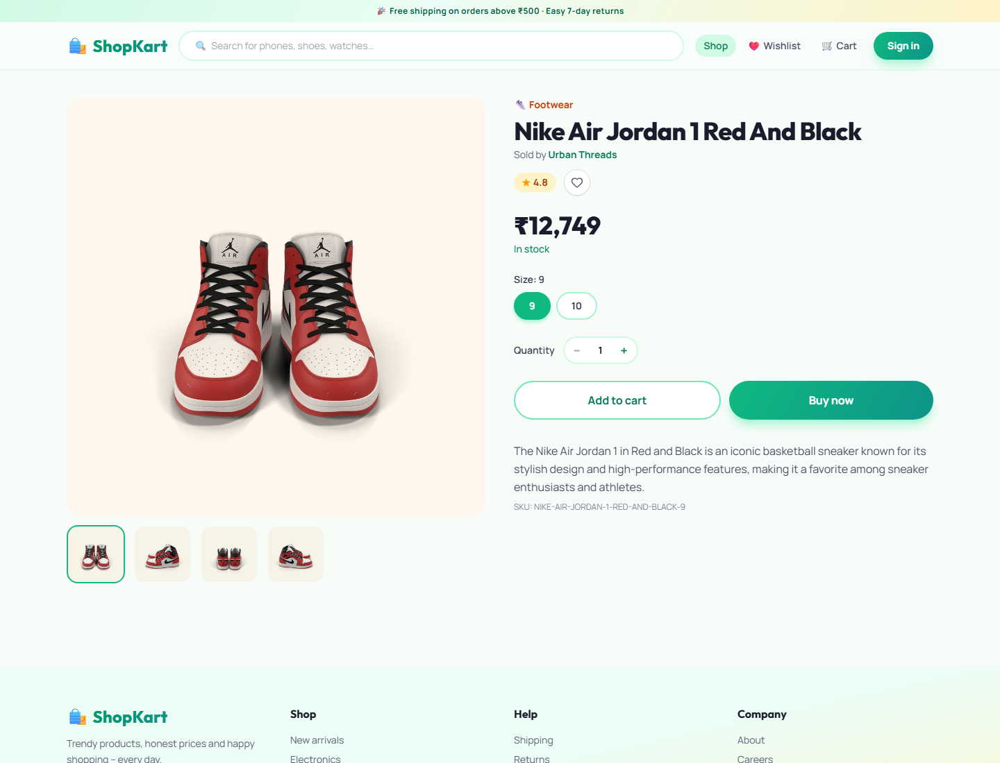
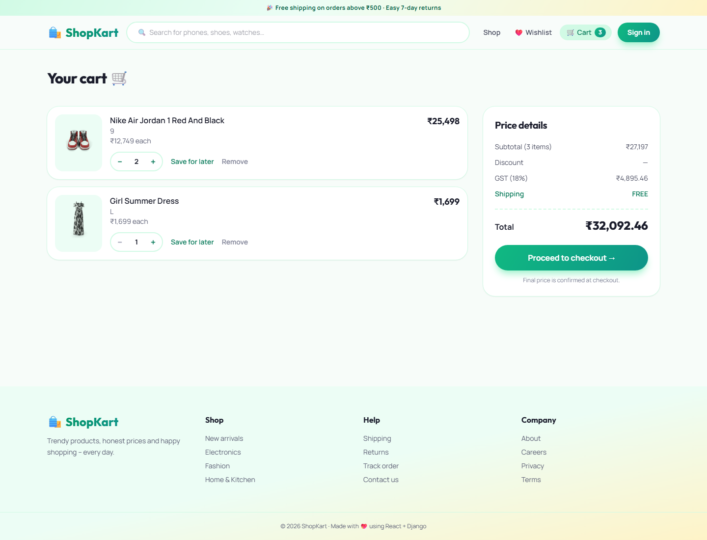
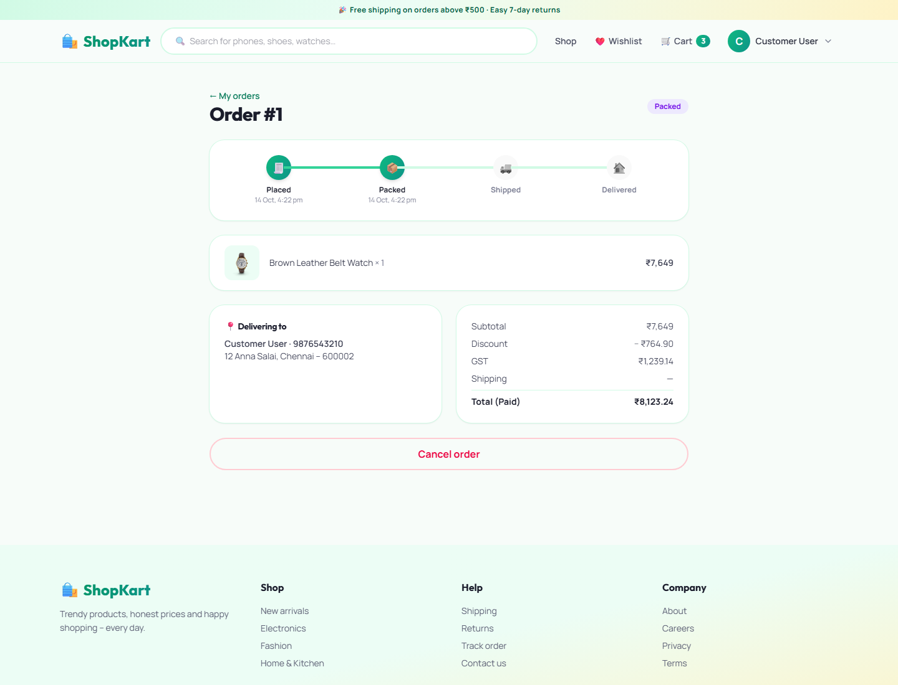
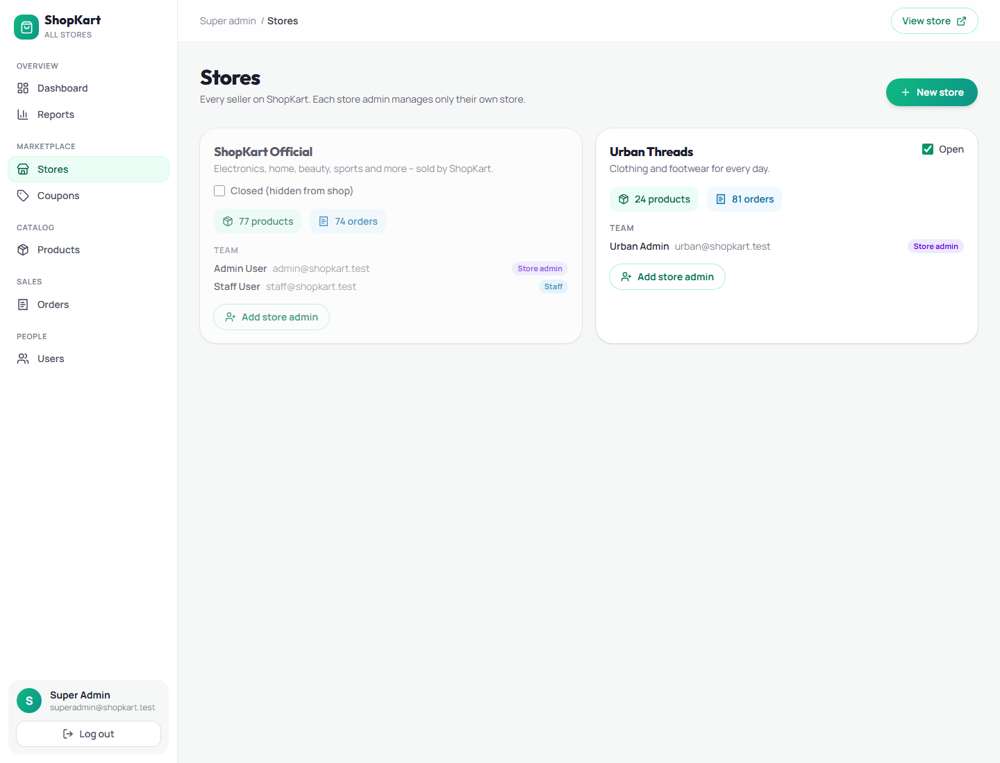
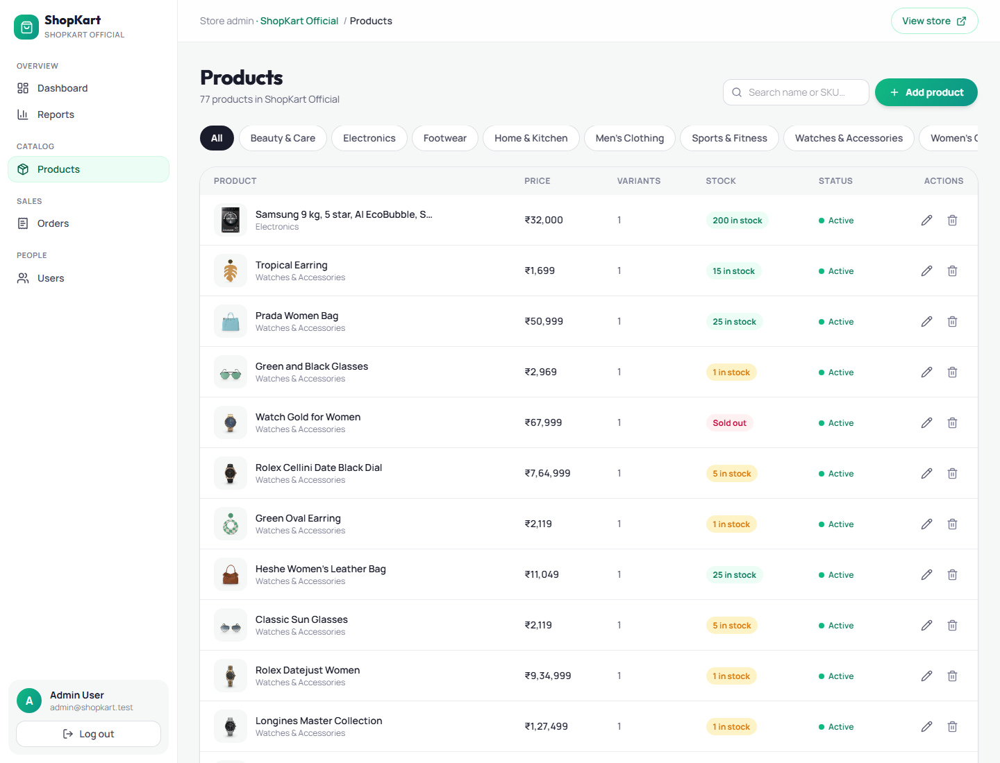

# 🛍️ ShopKart – E-commerce Shopping Cart with Admin

A small Amazon / Flipkart-style shop: customers browse products, add to cart, apply coupons,
pay (Razorpay test mode) and track orders. Admin and staff manage products, stock, coupons and orders.

## Tech stack

| Part | Tech |
|---|---|
| Frontend | React (Vite), React Router, Tailwind CSS, axios |
| Backend | Python, Django, Django REST Framework |
| Database | PostgreSQL 16 (Docker) |

## Project structure

```
ecommerce-shop/
├── frontend/          React app
│   └── src/
│       ├── api/       all API calls (axios)
│       ├── components/
│       ├── context/
│       ├── hooks/     custom hooks
│       ├── layouts/
│       └── pages/
├── backend/           Django API
│   ├── config/        settings, main urls
│   ├── accounts/      users, roles, login / register API
│   ├── catalog/       categories, products, variants API (+ seed data)
│   ├── cart/          price rules + quote API
│   ├── coupons/       coupon rules
│   ├── orders/        addresses, orders, payments, stock
│   ├── backoffice/    admin panel APIs
│   └── dashboard/     admin dashboard API
└── docs/              database design
```

## Setup

### Database (PostgreSQL in Docker – no installer or admin rights needed)
```bash
docker run -d --name shopkart-db --restart unless-stopped -e POSTGRES_DB=shopkart -e POSTGRES_USER=shopkart -e POSTGRES_PASSWORD=change-me -p 127.0.0.1:5434:5432 -v shopkart-pgdata:/var/lib/postgresql/data postgres:16
```
Port **5434** is used so it does not clash with other local PostgreSQL containers. Put the same password in `backend/.env`.

### Backend (Windows, Command Prompt)
```bash
cd backend
python -m venv .venv
.venv\Scripts\python -m pip install -r requirements.txt
copy .env.example .env
.venv\Scripts\python manage.py migrate
.venv\Scripts\python manage.py seed_products
.venv\Scripts\python manage.py seed_stores    # second demo store: Urban Threads
.venv\Scripts\python manage.py seed_users
.venv\Scripts\python manage.py seed_orders   # optional: 150 FAKE orders to try the charts (remove with --clear)
.venv\Scripts\python manage.py runserver 127.0.0.1:8000
```
API: http://127.0.0.1:8000/api/health/

> Use `127.0.0.1` (not `localhost`): Docker also listens on port 8000 on this machine.

### Demo accounts (created by `seed_stores` + `seed_users`)

| Role | Email | Password | Sees |
|---|---|---|---|
| Super admin | superadmin@shopkart.test | Shop@1234 | All stores · creates stores and store admins · coupons |
| Store admin | admin@shopkart.test | Shop@1234 | ShopKart Official only |
| Store admin | urban@shopkart.test | Shop@1234 | Urban Threads only |
| Staff | staff@shopkart.test | Shop@1234 | ShopKart Official orders |
| Customer | customer@shopkart.test | Shop@1234 | Shop |

### Multiple stores

- **Super admin** creates stores and their **store admins** (Admin → Stores).
- A **store admin** only sees and manages their own store's products, orders, staff, dashboard and reports.
- **One store per order**: adding an item from another store asks to start a new cart (the old items move to *Saved for later*).

## API

| Method | URL | Who |
|---|---|---|
| POST | `/api/auth/register/`, `/api/auth/login/` | Anyone |
| POST | `/api/auth/logout/` · GET `/api/auth/me/` | Logged in |
| GET | `/api/categories/`, `/api/products/?search=&category=&ordering=&page=`, `/api/products/<slug>/` | Anyone |
| POST | `/api/cart/quote/` – server-side price (items + coupon) | Anyone |
| GET / POST | `/api/addresses/` · PUT / DELETE `/api/addresses/<id>/` | Logged in |
| GET / POST | `/api/orders/` – my orders / place order | Logged in |
| GET | `/api/orders/<id>/` | Owner |
| POST | `/api/orders/<id>/pay/`, `/pay/verify/`, `/pay/failed/`, `/cancel/` | Owner |
| GET | `/api/admin/dashboard/` | Admin |
| CRUD | `/api/manage/products/`, `/api/manage/coupons/`, POST `/api/manage/uploads/` | Admin |
| GET | `/api/manage/orders/?status=&search=` · POST `/next-status/` | Staff + admin |
| POST | `/api/manage/orders/<id>/cancel/` · `/api/manage/users/` + PATCH `/<id>/role/` | Admin |

Run backend tests: `.venv\Scripts\python manage.py test` (57 tests, including a real two-thread "last item" race on PostgreSQL)

## Payments (Razorpay test mode)

1. Create a free account at https://razorpay.com → switch to **Test mode** → Settings → API Keys → Generate.
2. Put the keys in `backend/.env`:
   ```
   RAZORPAY_KEY_ID=rzp_test_xxxxx
   RAZORPAY_KEY_SECRET=xxxxx
   ```
3. Restart the backend. Checkout now opens the real Razorpay popup (test cards, no real money).

Without keys the app uses a **mock payment screen** (Pay successfully / Make payment fail).
The backend always verifies the payment (HMAC signature) before reducing stock.

## Screenshots

| Shop | Product (variants, "Sold by") |
|---|---|
|  |  |
| **Product list with filters in the URL** | **Cart (guest cart, stock limits)** |
|  |  |
| **Checkout – price verified by the server** | **Order tracking timeline** |
|  |  |
| **Store admin dashboard** | **Sales report (Recharts)** |
|  |  |
| **Super admin – stores and store admins** | **Store admin – own products only** |
|  |  |

All pages were also checked at phone width (390px).

## Database schema


## Progress

- [x] Day 1 – Project setup, DB design, seed data (100 products with real photos from DummyJSON)
- [x] Day 2 – Auth with customer / staff / admin roles; role-based routes and API protection; product list, detail and admin dashboard
- [x] Day 3 – Product list with search, category, price range, rating filters and sort (filters in the URL)
- [x] Day 4 – Product detail with images and variants; wishlist
- [x] Day 5 – Cart with Context + useReducer, stock limit, guest cart in localStorage
- [x] Week 2 – Coupons, price summary, checkout with addresses, Razorpay / mock payment, stock lock
- [x] Week 3 – My orders with timeline + cancel; admin panel (products, coupons, orders, users); staff orders
- [x] Guest cart merge into the account cart (saved in the DB) and cross-tab cart sync
- [x] Sales report – daily revenue, top products, revenue by category (Recharts, lazy-loaded)
- [x] Multiple stores: super admin, store admins, one store per order
