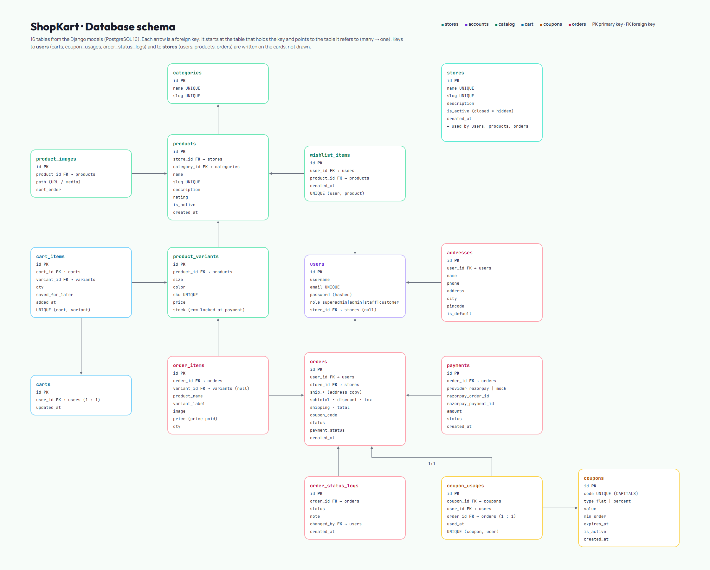
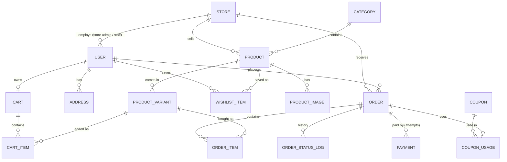

# Database Design – ShopKart

Database: **PostgreSQL 16** (Docker, port 5434). Every table below is a **Django model**;
Django creates and changes the tables with `makemigrations` + `migrate`.

## How the tables connect

Read `||--o{` as **"one … has many …"**. Example: one STORE sells many PRODUCTs.

## Roles

| Role | Store | Can do |
|---|---|---|
| `superadmin` | – | All stores; creates stores and store admins; coupons |
| `admin` (store admin) | required | Only their store: products, stock, orders, staff, dashboard, reports |
| `staff` | required | Only their store's orders: move status forward |
| `customer` | – | Shop, cart, wishlist, orders |

## Tables (Django names: `app_model`)

### stores app
| Table | Columns | Notes |
|---|---|---|
| `stores_store` | id, name (unique), slug (unique), description, is_active, created_at | Inactive → products hidden from the shop, data kept |

### accounts app
| Table | Columns | Notes |
|---|---|---|
| `accounts_user` | id, username, email (unique), password (hashed), first_name, **role**, **store_id → stores** | Django's built-in user + role + store |
| `authtoken_token` | key, user_id | Login token sent as `Authorization: Token …` |

### catalog app
| Table | Columns | Notes |
|---|---|---|
| `catalog_category` | id, name, slug | |
| `catalog_product` | id, **store_id**, category_id, name, slug, description, rating, is_active, created_at | No price here – the price is on the variant |
| `catalog_productimage` | id, product_id, path, sort_order | `path` = full URL (seed) or `/media/…` (upload) |
| `catalog_productvariant` | id, product_id, size, color, sku (unique), price, stock | Cart and orders point to a **variant** |
| `catalog_wishlistitem` | id, user_id, product_id, created_at | UNIQUE (user, product) |

### cart app
| Table | Columns | Notes |
|---|---|---|
| `cart_cart` | id, user_id (1 : 1), updated_at | Logged-in users only; guests use localStorage |
| `cart_cartitem` | id, cart_id, variant_id, qty, saved_for_later, added_at | UNIQUE (cart, variant) |

### coupons app
| Table | Columns | Notes |
|---|---|---|
| `coupons_coupon` | id, code (unique, CAPITALS), type (flat / percent), value, min_order, expires_at, is_active, created_at | Shop-wide, managed by the super admin |
| `coupons_couponusage` | id, coupon_id, user_id, order_id (1 : 1), used_at | UNIQUE (coupon, user) = one use per user |

### orders app
| Table | Columns | Notes |
|---|---|---|
| `orders_address` | id, user_id, name, phone, address, city, pincode, is_default | Saved addresses |
| `orders_order` | id, user_id, **store_id**, ship_name / phone / address / city / pincode, subtotal, discount, tax, shipping, total, coupon_code, status, payment_status, created_at | One order = one store. The address is **copied** so old orders never change |
| `orders_orderitem` | id, order_id, variant_id (null if deleted), product_name, variant_label, image, price, qty | `price` = the price paid, not today's price |
| `orders_orderstatuslog` | id, order_id, status, note, changed_by → user, created_at | Builds the tracking timeline |
| `orders_payment` | id, order_id, provider (razorpay / mock), razorpay_order_id, razorpay_payment_id, amount, status, created_at | One row per payment **attempt** (failed + retry) |

### sitecontent app (texts the super admin changes in Admin → Site content)
| Table | Columns | Notes |
|---|---|---|
| `sitecontent_sitesettings` | id (always 1), announcement_enabled, announcement_text, hero_badge, hero_title, hero_highlight, hero_subtitle, footer_tagline, updated_at | One row only ("singleton") |
| `sitecontent_perk` | id, icon, title, text, sort_order | Max 6 cards under the home banner |
| `sitecontent_footerlink` | id, group, label, url, sort_order | `url` must be `/page` or `http(s)://…` (no `javascript:`) |

## Status values

- `orders_order.status`: `pending_payment` → `placed` → `packed` → `shipped` → `delivered`, or `cancelled`
- `orders_order.payment_status`: `pending`, `paid`, `failed`, `refund_pending`
- `orders_payment.status`: `created`, `success`, `failed`

## Business rules the database enforces

| Rule | How |
|---|---|
| Two users buy the last item | `transaction.atomic()` + `select_for_update()` locks the variant row; stock is reduced with `UPDATE … WHERE stock >= qty` |
| Stock never negative | `stock` is a positive integer + the conditional update above |
| One coupon use per user | UNIQUE (coupon, user) on `coupons_couponusage` |
| One wishlist row per product | UNIQUE (user, product) on `catalog_wishlistitem` |
| One cart row per variant | UNIQUE (cart, variant) on `cart_cartitem` |
| A store or category with products can't be deleted | `on_delete=PROTECT` on `store_id` / `category_id` |
| Old orders stay correct | `orderitem.price`, `orderitem.product_name` and `order.ship_*` are **copies** |
| Price never trusted from the browser | The backend recalculates from `productvariant.price` at checkout |
