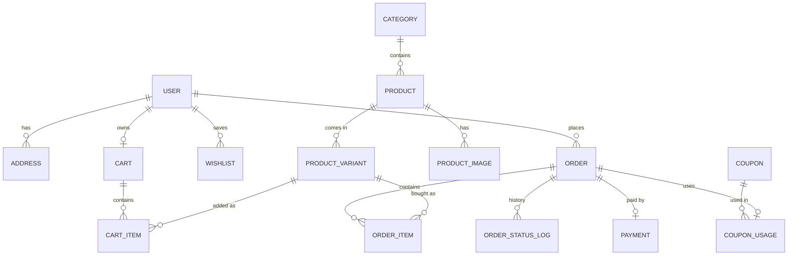

# Database Design – ShopKart

Database: **PostgreSQL** (SQLite is used temporarily during setup).
Each table below becomes one **Django model** (a Python class). Django creates the
tables for us with `makemigrations` + `migrate`.

## How the tables connect

Read `||--o{` as **"one … has many …"**. Example: one CATEGORY contains many PRODUCTs.

## Why variants are a separate table

A T-shirt has ONE name and description, but **each size/colour has its own price and stock**:

| product | size | color | price | stock |
|---|---|---|---|---|
| Cotton T-Shirt | M | Black | 499 | 12 |
| Cotton T-Shirt | L | Black | 499 | 0 |
| Cotton T-Shirt | M | White | 549 | 7 |

So the **cart and orders point to a variant**, not to the product.
"Can't add more than available stock" is checked against `product_variants.stock`.

## Tables

### accounts app
| Table | Columns | Notes |
|---|---|---|
| `users` | id, username, email, password, **role** | Django's built-in user + role (customer / staff / admin). ✅ Created on Day 1 |
| `addresses` | id, user_id → users, name, phone, address, city, pincode, is_default | One user, many saved addresses |

### catalog app
| Table | Columns | Notes |
|---|---|---|
| `categories` | id, name, slug | slug = URL-friendly name (`mens-clothing`) |
| `products` | id, category_id → categories, name, slug, description, rating, is_active | No price here – price lives on the variant |
| `product_images` | id, product_id → products, path, sort_order | Many images per product |
| `product_variants` | id, product_id → products, size, color, sku, price, stock | sku = unique stock code |
| `wishlists` | id, user_id → users, product_id → products | Unique per (user, product) |

### cart app
| Table | Columns | Notes |
|---|---|---|
| `carts` | id, user_id → users | Guest cart lives in localStorage, merged on login |
| `cart_items` | id, cart_id → carts, variant_id → product_variants, qty, saved_for_later | |

### coupons app
| Table | Columns | Notes |
|---|---|---|
| `coupons` | id, code, type (flat / percent), value, min_order, expires_at, is_active | |
| `coupon_usages` | id, coupon_id → coupons, user_id → users, order_id → orders | Unique per (coupon, user) = one use per user |

### orders app
| Table | Columns | Notes |
|---|---|---|
| `orders` | id, user_id, address_id, subtotal, discount, tax, shipping, total, status, payment_status | Prices are **copied** at order time (they may change later) |
| `order_items` | id, order_id, variant_id, qty, price | price = price at the moment of buying |
| `order_status_logs` | id, order_id, status, changed_by → users, created_at | Builds the status timeline |
| `payments` | id, order_id, razorpay_order_id, razorpay_payment_id, status | |

## Rules the database helps with

| Business rule | How |
|---|---|
| Two users buy the last item | `transaction.atomic()` + `select_for_update()` locks the variant row |
| One coupon use per user | Unique constraint on (coupon, user) |
| Price never trusted from frontend | Backend recalculates from `product_variants.price` |
| Order history stays correct | `order_items.price` stores the price paid, not a link to today's price |

## Build order
1. ✅ `users` (Day 1 – needed before the first migration)
2. ⏭️ `categories`, `products`, `product_images`, `product_variants` → load seed data
3. `addresses`, `wishlists` → `carts`, `cart_items` → `coupons` → `orders`, `payments`
